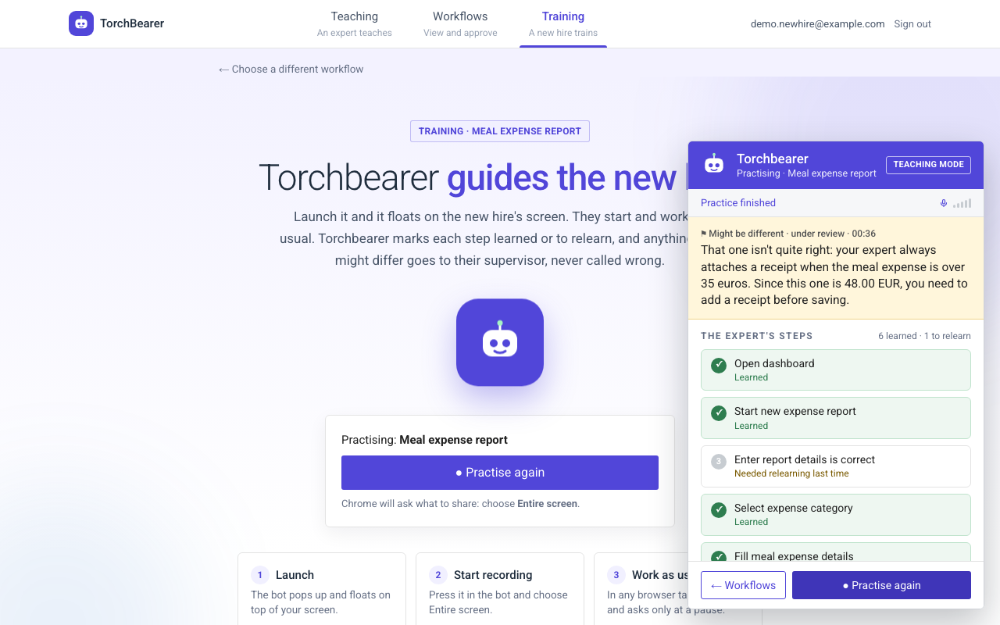

<p align="center"></p>
<h1 align="center">TorchBearer</h1>
<p align="center"><b>The AI Apprentice.</b> It watches experts work, asks why at the right moment,<br>and teaches what they know to the next generation.</p>

<p align="center">
  <a href="https://main.d3dd61qwuyekg8.amplifyapp.com">Website</a> ·
  <a href="https://aws.d32tnuo1sla34.amplifyapp.com/capture">Live app</a> (invite-only) ·
  <a href="docs/aws-deployment.md">Architecture &amp; decisions</a>
</p>

<p align="center">
  
  <br><sub>Training: TorchBearer catches a meal over 35&nbsp;€ saved without a receipt (the expert's rule) and tracks each step the new hire has learned.</sub>
</p>

---

## Why

Every day, 11,200 Americans reach retirement age, and 42% of what an employee knows exists only in their head. Process docs skip the exceptions and the *why*, go stale after the next change, and nobody rewatches an hour of screen recording. When an expert leaves, that part of the job leaves with them.

## How it works

| | Step | What happens |
|---|---|---|
| 1 | **Capture** | The expert shares their screen and works as usual. A voice agent stays quiet while they type and asks one short *why* question at natural pauses: *"You moved that one to capex. What made you do that?"* |
| 2 | **Map** | A short debrief, then a teach-back the expert confirms. The result is a **Work Map**: every step, the reason in the expert's own words, and the guardrails. |
| 3 | **Teach** | A voice tutor coaches the new hire on their own screen, on cases the expert never showed. It steps in *before* a wrong save (*"Your expert would stop here. Why do you think?"*), sends anything unusual to a supervisor, and ends with a mastery report. |

The demo workflow is meal expenses in **Ledgerline**, a simulated expense tool bundled in `public/ledgerline/`.

## Architecture

```
Browser (Chrome)
  │  HTTPS
  ▼
AWS Amplify Hosting ── Next.js pages + API routes
  │          │                        │
  │          │ IAM role               │ API keys (Amplify env vars)
  │          ▼                        ▼
  │     Amazon S3                 Gemini: reads the screen, builds the Work Map, coaches
  │     (workflows, progress,     ElevenLabs: session tokens for the voice agents
  │      reviews)
  └── Voice runs directly between the browser and ElevenLabs (WebRTC)
```

| Layer | Choice |
|---|---|
| App | Next.js 16 (App Router, TypeScript), Tailwind |
| Voice | ElevenLabs Agents (`@elevenlabs/react`): an Interviewer for Capture, a Tutor for Teach |
| Vision + reasoning | Gemini, called only from server routes |
| Hosting | AWS Amplify Hosting (server-rendered), deploys on every push to `aws` |
| Sign-in | Amazon Cognito managed login, invite-only; each account belongs to one company |
| Data | Amazon S3, versioned, encrypted, private; each company's data under its own `orgs/<company>/` prefix |
| Website | Static page on a second Amplify app ([torchbearer-site](https://github.com/NingchenMa/torchbearer-site)) |

Why S3 and not DynamoDB, why Amplify and not ECS, what changes at the first pilot (Cognito sign-in, per-company data, Aurora PostgreSQL), and what it costs: see **[docs/aws-deployment.md](docs/aws-deployment.md)**.

## Run it locally

```bash
npm install
cp .env.example .env.local     # add ELEVENLABS_*, GEMINI_API_KEY, S3_BUCKET, S3_REGION, AWS_PROFILE
npm run dev                    # UI work, http://localhost:3000
npm run build && npm start     # anything involving voice (dev mode can drop the agent's audio)
```

Use Chrome, keep one TorchBearer tab open, and pick your microphone explicitly in the site settings.

| Page | What it is |
|---|---|
| `/vault` | The company's workflow vault: every trained workflow, train a new hire from any approved one |
| `/capture` | Learning mode: record an expert's workflow |
| `/map` | Review and correct the Work Map, then approve it |
| `/teach` | Teaching mode: a new hire practises an approved workflow |
| `/review` | Supervisor review of anything that might differ from the approved way |

Voice agent prompts live in [docs/agents.md](docs/agents.md); `npm run agents` pushes them to ElevenLabs.

## Deploy

Push to the `aws` branch. Amplify builds and deploys in about 5 minutes; roll back from the Amplify console. Secrets are set on the Amplify branch, never in the repo.

## Project layout

```
src/app/            pages and API routes (api/coach, api/observe, api/vision, api/workflows, ...)
src/features/       capture, workmap, teach, observe (coach), erp (Ledgerline bridge)
src/lib/            shared types, S3 storage (db.ts), Gemini client, session helpers
public/ledgerline/  the simulated expense tool used in demos
docs/               architecture decisions, agent prompts, data formats
```

## Status

Pre-pilot. Sign-in (Amazon Cognito) and per-company data separation are in. Next up: Aurora PostgreSQL for analytics.

<sub>TorchBearer started at the Hack-Nation × ElevenLabs 7th Global AI Hackathon.</sub>
